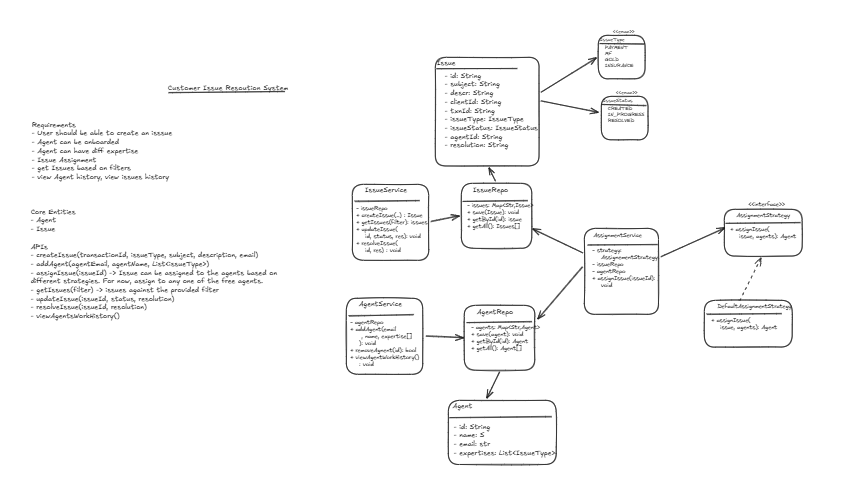

# Problem Statement

* PhonePe processes a vast number of transactions every day, wherein some transactions may fail (enter a FAILED state) or remain in a PENDING state due to various reasons such as bank or NPCI issues, or internal PhonePe errors.
* To handle such cases efficiently, a resolution system is needed, where customers can log their unsuccessful transactions and raise complaints against them.
* The system must categorize customer issues into several types, such as payment-related, mutual fund-related, gold-related, or insurance-related.
* Different customer service agents will have their specific expertise based on the issue type, whom the system will assign the issues by marking them waiting in case all agents are busy.
* The customer service agents can work on one issue at a time and update its status, and once it is resolved, the agent will receive another issue.

---

## Requirements

Your solution should implement the following functions.
Feel free to use the representation for objects you deem fit for the problem and the provided use cases.
The functions are ordered in the decreasing order of importance (highest to lowest).
We understand that you may not be able to complete the implementation for all the functions listed here.
So try to implement them in the order in which they are declared down below.

1. `createIssue(transactionId, issueType, subject, description, email)`
2. `addAgent(agentEmail, agentName, List<issueType>)`
3. `assignIssue(issueId)` `// -> Issue can be assigned to the agents based on different strategies. For now, assign to any one of the free agents.`
4. `getIssues(filter)` `// -> issues against the provided filter`
5. `updateIssue(issueId, status, resolution)`
6. `resolveIssue(issueId, resolution)`
7. `viewAgentsWorkHistory()` `// -> a list of issue which agents worked on`

Solution: 
